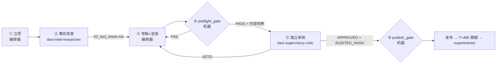

# 大熙教育 · 出稿流水线（3 方分权 + 2 道机器闸门）

> **原则**：写稿的人不核事实，写稿的人不批准发布。关键约束交给代码，不靠自觉。

## 三方权力（谁能写什么）

| 角色 | 是谁 | 可以写 | 不得写 |
| :--- | :--- | :--- | :--- |
| **生产** | 编排器（主对话） | `01_brief.md`、`text.md`、`index.html`、封面底图、`critic_audit.md`（仅转录） | `02_fact_sheet.md` 的事实内容；任何审核结论 |
| **事实** | `daxi-intel-researcher`（只读 + 联网） | 回传 fact sheet（编排器原样保存为 `02_fact_sheet.md`） | 文案 |
| **审核** | `daxi-supervisory-critic`（只读 + 联网 + 看图） | 结论（APPROVED / VETO_REJECT + 证据） | 任何文件（无写权限，无法自己改稿掩盖问题） |

## 两道机器闸门（为什么无法绕过）

| 闸门 | 检查 | 防的是什么 |
| :--- | :--- | :--- |
| `scripts/preflight_gate.py` | 规则全部来自 `config/rules.json`：标题、违禁词、装饰英文、页数页码、DOM 溢出、尺寸、**渲染哈希**、**QS 排名必须能在 fact sheet 找到** | 低级错误；图文不一致；主笔自己编数字 |
| `scripts/publish_gate.py` | preflight PASS 且哈希一致；**直接读取 critic 对话的原始记录**，要求 critic 对**当前内容哈希**的最后结论是 APPROVED | 伪造审核结论；审完再偷偷改稿 |

## 工位细则
1. **立项**：查 `tracker/posts_master.csv` 防撞题；按 `experiments/` 当期排期确定封面变体；按 `templates/01_brief.md` 填写。
2. **事实核查**：调用 `daxi-intel-researcher`，给它 brief 和 `knowledge/facts_2026.md`。fact sheet 必须是声明表格式（`templates/02_fact_sheet.md`）。核查到的新事实同步回 `knowledge/facts_2026.md`。
3. **写稿 + 渲染**：遵守 `config/brand.md` 和 `config/editorial.md`；运行 `python3 scripts/render_deck.py posts/<id>`。
4. **preflight**：`python3 scripts/preflight_gate.py posts/<id>`。FAIL 退回第 3 步。PASS 时记下输出的 `content_hash`。
5. **独立审核**：按 `templates/critic_request.md` 调用 `daxi-supervisory-critic`（同一天中午 + 晚上两篇合并送审一次）。VETO → 回到第 3 步修改 → 重新渲染、preflight → 把**新哈希**发给**同一个 critic** 复审。APPROVED → 按 `templates/critic_audit.md` 转录（必须含 `conversation://<critic 对话 id>`）。
6. **publish**：`python3 scripts/publish_gate.py posts/<id>` 显示 ✅ 后，才能更新 tracker 并发布。发布后按 `experiments/` 用 `scripts/log_metrics.py` 录入数据。

